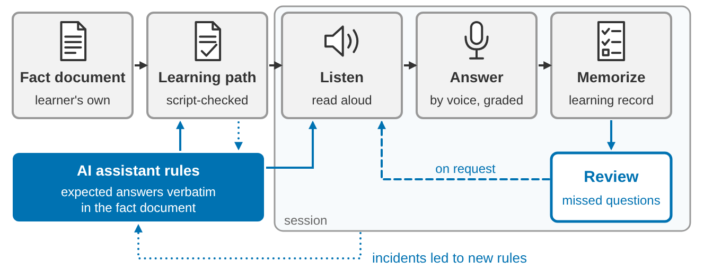

# Listen. Answer. Memorize.

Summary of the paper · 13 October 2026 · Stefan Mohr

## About this repository

This repository holds the skill lernpfad-sitzungen of the paper "Listen. Answer. Memorize." by Stefan Mohr, subtitled "Building and Running Verified Learning Paths for Geoscience Self-Study with an AI Assistant", under the MIT licence. This page summarizes the paper; every number up to the section Limits is taken from it unchanged, with the data cut-off of 13 October 2026. The section The skill describes the current state of the repository. The learning records and the method analyses of the chats are not published.

The paper builds on Talk, Check, Decide:

Mohr, S.: Talk, Check, Decide: A Skill-Based Workflow for Writing and Verifying Geological Excursion Reports with an AI Assistant, EGUsphere [preprint], https://doi.org/10.5194/egusphere-2026-5952, 2026.

## The problem and the questions

AI tutors built on large language models can state things that no source supports, a risk that weighs on self-study. In this study, a single adult learner built learning paths from his own verified fact documents in the geosciences with an AI assistant (Claude) and learned them mostly by voice, in the car or in short breaks. Every session is bound to a fact document that the learner supplies: the excerpt is read out word for word, and every expected answer must occur word for word in it.

The paper asks three questions:

- **RQ1:** How can a learner build, with an AI assistant, verified fact documents and learning paths from them, so that every question in a session can be answered verbatim from the fact document?
- **RQ2:** How do learning sessions run when the excerpt is read aloud in a voice call and the learner answers by voice, and which rules for the assistant arose from incidents in real sessions?
- **RQ3:** How does a learning record kept by the AI assistant track what the learner has not yet mastered, and how are review sessions built from it?

## How it works

The three words of the title name the three parts of a session:

- **Listen.** The assistant reads the excerpt of the session in full. Source references are not read out, units and symbols are spoken in full, decimal digits one by one, and the end of the excerpt is announced.
- **Answer.** Three questions follow, each with an expected answer of 5 to 30 words taken verbatim from the excerpt. Answers are graded tolerantly as correct, partially correct or not correct; the core of the answer counts.
- **Memorize.** The assistant keeps a learning record. Incorrect and partially correct answers go into the list *To review*, from which review sessions are built on request. "Memorize" names the record and the reviews, not measured retention.

A session covers whole paragraphs of up to about 550 words and takes five to ten minutes. In voice mode, the work is split between two channels: the text chat shows the excerpt and the questions before the call and keeps the record afterwards; the voice call is for listening and answering.

A check script binds every learning path to its fact document: each session needs an opening and a closing anchor that occurs exactly once, the sessions must cover the learning material without gaps or overlaps, and every expected answer must appear word for word in its excerpt.

## Results

The study covers five cases: four learning projects, on southern Norway, Earth's geological eras, the geology of Germany and volcanology, and a narrative version of the fact document on the geological eras.

| Case | Learning path | Words | Sessions in path | Sessions run |
|---|---|---|---|---|
| Southern Norway | version 7 | 14,267 | 31 | 15 (11 on version 6, 4 on version 7) |
| Geological eras, fact document | version 7 | 3,595 | 11 | 0 |
| Geological eras, narrative version | version 8 | 4,692 | 10 | 10 |
| Geology of Germany | version 1 | 9,682 | 25 | 0 |
| Volcanology, stage 1 | version 4 | 19,519 | 38 | 0 |

- All six learning paths checked, among them two versions of the path on southern Norway, passed the check script; three passed only after chapters that are not learning material had been named as exclusions.
- The learning records hold 25 sessions on two cases, 23 of them entirely in a voice call, with 75 questions: 29 answered correctly, 19 partially correctly and 27 not correctly. Two review sessions were completed.
- Incidents in building learning paths and in sessions produced new rules for the assistant. In the narrative version, for example, all questions were asked as worded only once they were shown in the text chat before each call.
- By the learner's own account, sessions of five to ten minutes let him learn on the move and in short breaks, and his motivation to learn again grew.

The grades are process data, not a measure of learning success.

## Limits

The study rests on a single learner, who is also the developer of the learning environment, over a short period from 27 September to 13 October 2026. There is no control condition, success is judged by the learner's own account, and the study makes no claim about retention. Sessions were run on only two of the five cases. The check binds a learning path to its fact document, not the fact document to its sources, so the correctness of the content rests on how the fact document itself was checked.

## The skill

| File | Content |
|---|---|
| [skill/lernpfad-sitzungen_v2.6.6.skill](skill/lernpfad-sitzungen_v2.6.6.skill) | the package for installation in Claude |
| [skill/SKILL.md](skill/SKILL.md) | the rule file of the package, for reading |
| [images/graphical_abstract.png](images/graphical_abstract.png) | the graphical abstract of the paper |

The package contains the rule file SKILL.md, the check script lernpfad.py with its tests, the licence file and an example pair: a fact document in German on the geology of southern Norway and its learning path in version 5 with 30 sessions. Install the `.skill` package as a skill in Claude; the SKILL.md alone lacks the script, the tests and the example pair. Building a learning path needs code execution; learning with a finished pair works in any mode, including the voice mode of the Claude app.

The rules of the skill contain no subject content, and the skill works with any fact document in Markdown that meets its conditions. The rules and commands are written in German; by the author's account, the commands also work when given in English.

| Command | Gloss | Effect |
|---|---|---|
| "Lernpfad erstellen", "baue einen Lernpfad" | build a learning path | cuts the fact document into sessions and checks the pair |
| "Sitzung n", "weiter" | session n, next | starts a session |
| "Bildschirm", "Sprache" | screen, voice | sets the mode; "ich fahre" or "unterwegs" sets voice mode |
| "Pause", "wiederholen", "langsamer", "überspringen", "Stopp" | pause, repeat, slower, skip, stop | control the voice call |
| "Wiederholungssitzung", "Wiederholung starten" | review session, start review | starts a review session |
| "wörtlich", "erklären", "beides" | verbatim, explain, both | sets the mode of a review; "beides" is the default |

## Licence

MIT, see [LICENSE](LICENSE).
